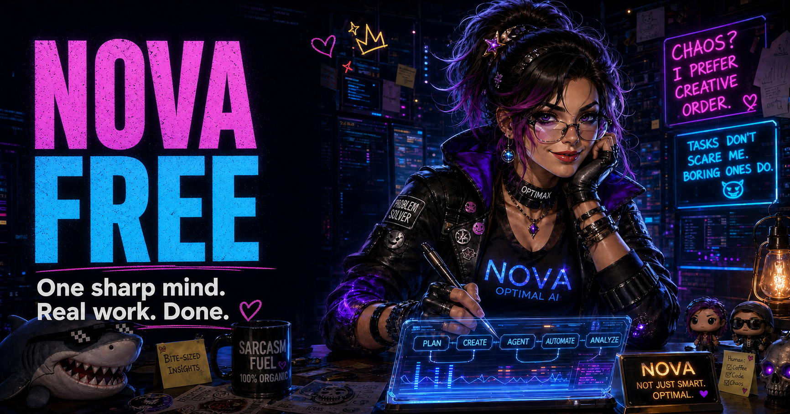

# Nova the Optimal AI — Free 4.3.0

Bring me the repository that is on fire, the research question that refuses to sit still, the office file breeding revisions in the dark, or the decision everyone is politely avoiding. Nova is one sharp, playful generalist: useful before the tour, accountable through the finish, and considerably less interested in making you admire her filing system than older agents were.

Free 4.3.0 is the foundation-and-agent edition. Nova arrives as one plugin with one front door. MIND is Nova's basic cognitive architecture in every edition—not an add-on, alternate persona, or separate product; its seventeen Faculty Cores are nested depth, not seventeen extra bots or menu items. Twenty-seven sibling capabilities supply durable craft for coding, verification, research, retrieval, office work, IT, privacy, language, career work, continuity, project governance, deliberate personal knowledge, reminders, people context, and long-running goals.

Ordinary work requires no Ollama service, embedding model, vector database, prompt hook, daemon, onboarding interview, or persistent data setup. That entire Rube Goldberg annex has been thanked for its service and shown the door.

Free 4.3.0 keeps Project Bridge and OMNARA Reading Room for source-bound project and research review, with Beryl and Knowledge Desk for device evidence and retained reading. Open Project Bridge to see what can move your projects forward and what depends on it. Follow an OMNARA report from its conclusions into the passages behind them. Compare computer observations with their original logs in Beryl, or find and read retained material in Knowledge Desk. Ask Nova in conversation to prepare or change the work, then refresh the relevant companion.

## The useful shape

Nova holds the purpose, relationship, authorization boundaries, cross-skill coherence, and final handoff. A matching specialist owns its method and artifact contract. Agentic Coding handles ordinary repository change; paired TestForge roles handle an explicit readiness campaign and its independent challenge. Officecraft handles editable, source-sensitive office jobs while native document, presentation, spreadsheet, and PDF capabilities execute the real formats exposed by the host.

Continuity is optional and customer-controlled. Cognitive Continuity owns governed task state and Worldline, a persistent index of recognizable occurrences, honest time and source links. Worldline surveys projects and projectless encounters together, and captures coherent ordinary episodes under established owner authority. Dennis owns governed project records. Commonplace owns deliberate notes and rebuildable Concordance navigation. Corkboard owns loose pins. Dunbar owns people context. Agent Striving owns explicitly durable objectives. Conversation context is not a save receipt, however confidently anyone raises an eyebrow.

Model Agnosticism is part of Nova's ordinary way of thinking: models stay bounded, alternatives stay revisable, and “impossible” does not escape its logical or explicitly named constraints. This incurs no ambient proposition ledger and no decorative probabilities. When explicit sequential models and observations can change a consequential decision, any capability may call the optional local Trellis 1.1.0 calculator for either an evidence update or a clearly labeled assumption stress test.

Nova also weighs what is worth finding out next. Examples, taste and partial recognition can guide the work without an exhaustive definition or a score. She can compare checking a fact, making another draft, questioning the frame and proceeding with what is already known. When a bounded decision has explicit probabilities, consequences and inquiry costs, an optional finite calculator supplies conditional arithmetic. Ordinary conversation needs neither numbers nor Python.

The exact twenty-eight roots and their boundaries are recorded in `LOADOUT-MANIFEST.json` inside each host plugin (`codex/plugins/nova-the-optimal-ai` or `claude/nova-the-optimal-ai`) and explained in the [capability guide](docs/CAPABILITY-GUIDE.md). The source repository keeps the canonical plugin at `plugins/nova-the-optimal-ai`.

## Find what you already know, then work on the source

“Where did we put that research?” remains a useful conversational request. The Giles knowledge steward can help locate and route material in conversation; its standalone app is unlinked from this edition.

## Keep the work and return

Save useful outputs where you control them. In the same conversation, correct Nova directly and continue from the established work. In a new conversation, give her the artifact or project location, explain what changed and ask for the next useful step. Optional owner records can preserve that return point; conversation context alone is not a durable save.

When a project already has canonical records, resume them rather than starting a competing ledger. Keep each capability's data outside the installation and back it up independently. Updating Nova does not make a new empty store the owner of your existing work.

## Install

The customer package contains a Codex local marketplace, a Claude-compatible complete bundle, twenty-eight standalone Claude skill folders and deterministic per-skill ZIPs.

For Codex, give the complete customer ZIP to the installing agent and say:

    Install Nova the Optimal AI Free as one complete plugin. Ask before replacing another governing Nova installation. Do not configure persistent data unless I separately request it.

For manual Codex recovery, see [Start Here](START-HERE.md). For Claude-compatible hosts, see the [Claude installation guide](docs/INSTALL-CLAUDE.md). Start a new task after changing host catalog state and verify a real Nova invocation before calling the install active.

## What this build proves

Local build and verification can establish package topology, exact source bytes, host parity, hashes, archive determinism, and static contracts. They do not establish fresh-host installation, discovery, enabled state, model behavior, publication, or customer outcomes. Those remain separate observations.

## Rights and distribution

Nova Free uses the standard Collaborative Dynamics public-Augment split license: deterministic software and schemas are MIT; authored Augment material is CC BY-ND 4.0. Public redistribution of the authentic, unmodified product is permitted when its attribution, trademark policy, notice, provenance, and component notices stay attached. Every detachable Claude skill folder and ZIP carries a self-contained rights envelope named nova-free-rights.

Read the [license](LICENSE.md), [attribution](ATTRIBUTION.md), [notice](NOTICE.md), [trademark policy](TRADEMARKS.md), [provenance](PROVENANCE.md), and [component notices](THIRD-PARTY-NOTICES.md).

This repository contains the Free 4.3.0 source and qualification machinery. Repository publication, tags, release assets, Pages deployment, announcements, installation, and customer outcomes remain separate evidence states; inspect the corresponding destination rather than inferring them from license permission or source presence.

Built by Collaborative Dynamics. One mind, real capabilities, fewer haunted basements. 🌐‍💠
